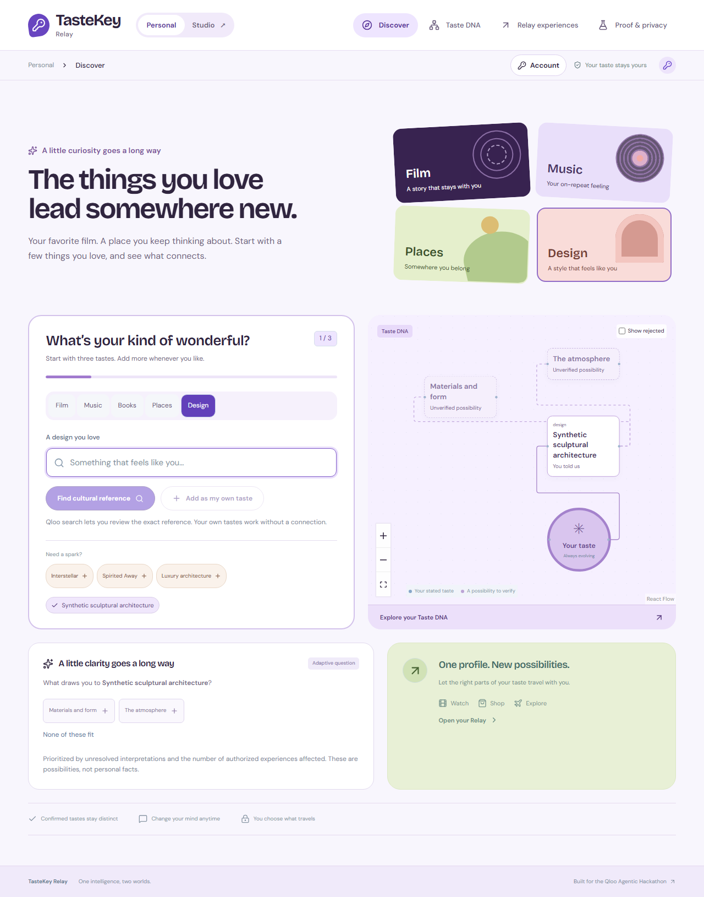

# TasteKey Relay

**One intelligence, two worlds.** A local-first personal taste identity and a private business cultural advisor, sharing Qloo evidence and explicit disclosure controls.

[Personal](https://tastekey.52.47.205.18.sslip.io/personal/discover) · [Studio](https://tastekey.52.47.205.18.sslip.io/studio/onboarding) · [Source](https://github.com/marwanehmamouchi05/tastekey-relay) · [Judge walkthrough](docs/JUDGE_GUIDE.md)



## What is implemented

Personal captures explicit preferences, asks adaptive clarification questions, displays an editable graph, and grants selected fields to entertainment, shopping and travel for 24 hours. Inferences remain unverified until answered. Practical budgets are separate from aesthetics. Optional AI corrections require explicit text transmission and a reviewed application of changes. Qloo supplies cultural recommendations; shopping products/prices are labeled samples. Travel supports local filtering of dated, user-checked accommodation quotes, without claiming independently verified prices or bookable availability.

Studio saves private business profiles, investigates reviewed cultural references and city signals, presents evidence-linked pilot proposals, compares scenarios, creates editable action plans and records owner-reported outcomes. Rejected proposals and outcomes inform later investigations. Optional Amazon Nova Micro rewrites grounded proposals; validation preserves costs, evidence IDs and ownership. Deterministic planning remains available.

Owners can invite explicit, category-only audience contributions. Participants sign in with a verified email, choose categories and can withdraw across sessions. Contributions expire after 30 days. Reports require at least ten active verified-account contributions and suppress small groups and complements. Legacy anonymous contributions are excluded. Team members cannot contribute to their own business audience. Verified accounts do not establish unique independent people; this is not differential privacy. Studio never receives the Personal graph. A persisted five-dimension human evaluation form is included, but no independent user-study results or quality improvement are claimed.

Studio supports secure OpenID Connect sign-in through a dedicated Cognito Lite service, verified emails, workspace switching, email-bound invitations, owner/admin/editor/viewer roles, immediate membership revocation, ownership transfer and an access audit. First sign-in secures the browser's private workspace and revokes its old capability/recovery codes; returning accounts preserve new private drafts separately. Anonymous exploration retains one-use recovery codes. The redesigned taste atlas uses illustrated discovery tiles, clearer progress and responsive navigation. See [acceptance evidence](docs/STATUS.md), [security boundaries](docs/SECURITY.md) and [evaluation limits](docs/EVALUATION.md). Corporate SAML federation/SCIM, proof of unique people, live booking/pricing feeds and independent human evaluation remain outside this release.

## Run locally

Use Node 24 LTS or newer and pnpm 10.20.0. Node's SQLite module is required.

```sh
npm install --global pnpm@10.20.0
pnpm install --frozen-lockfile
pnpm dev
```

Open [Personal](http://localhost:3000/personal/discover) or [Studio](http://localhost:3000/studio/onboarding). Studio uses a private HTTP-only 30-day cookie. Save a recovery code and an export before clearing cookies; restoring the one-use code signs out older sessions. Personal graph data remains browser-local and is not restored by Studio recovery.

For verified accounts, configure an HTTPS `APP_ORIGIN`, `OIDC_ISSUER`, `OIDC_CLIENT_ID` and optional confidential `OIDC_CLIENT_SECRET`. Register exactly `APP_ORIGIN/api/auth/callback` with the identity provider. The authorization code flow uses PKCE, state, nonce and explicit ID-token signature verification; only `email_verified=true` is accepted. `OIDC_LOGOUT_URL` optionally clears the provider session. Verified app sessions expire after eight hours and team workspaces disable capability recovery. Local HTTP exploration intentionally leaves sign-in disabled. The dedicated AWS setup is documented in [identity setup](docs/IDENTITY.md).

Configure the issued Qloo credential privately with the official event harness:

```sh
pnpm qloo -- config set base-url https://hackathon.api.qloo.com
pnpm qloo -- setup --qloo
pnpm qloo -- setup --status
```

Alternatively, copy `.env.example` to `apps/web/.env.local` and configure private server variables. Never put keys in chat, source control, public configuration or client code. Restart after environment changes. Optional Bedrock requires the explicit `MODEL_AWS_*` credential variables, region, model and expiry shown in `.env.example`; an OpenAI-compatible adapter is also available. The app does not use a developer's default AWS credential chain. Production AI is capped at 40 attempted calls per UTC day in SQLite, with bounded inputs and output tokens.

```sh
pnpm verify:qloo
pnpm test
pnpm build
pnpm typecheck
pnpm exec playwright install chromium
pnpm test:e2e
pnpm audit
```

Live tests consume quota and are opt-in. `QLOO_BROWSER_LIVE=1` enables live Qloo browser coverage; `MODEL_BROWSER_LIVE=1` also invokes the configured model. Set `PLAYWRIGHT_BASE_URL` to an HTTPS origin to test a deployment with isolated sessions. Set `PLAYWRIGHT_SCREENSHOTS` to a new folder to preserve prior captures. Test businesses and reported outcomes are explicitly synthetic, not customer evidence.

## Architecture and operations

- `apps/web`: Next.js, TypeScript, Tailwind and React Flow; server API and tenant-scoped SQLite.
- `packages/taste-engine`, `privacy-engine`: graph state, corrections, expiry, revocation and disclosure gates.
- `packages/qloo-adapter`: official harness 0.1.26 via argument-array subprocess, no shell; 25-second timeout, bounded retry, five-minute cultural cache and at most two concurrent children.
- `packages/studio-engine`, `agent-orchestrator`: evidence, constrained planning, scenario/outcome feedback and validated optional model output.
- `packages/evaluation`: common-pool exploratory ranking observations and dated quote filtering.

Cultural traces preserve public entity IDs and bounded evidence, not credentials. Budgets do not go to Qloo. Production Qloo allowance is 60 attempted workflows per hour; this application limit is separate from the organizer's unverified event quota. Qloo throttling resets on restart; the model's daily allowance persists. The pinned pnpm lockfile applies security overrides to harness dependencies; do not generate an npm lockfile.

The public deployment uses a non-root Node container on AWS Lightsail, Caddy HTTPS, a static IP and persistent volume. See [AWS operations](docs/AWS.md) and [deployment](docs/DEPLOYMENT.md). Automated daily consistent SQLite backups retain roughly seven days on the host; off-host recovery is a separate responsibility. Hosting and model usage consume applicable AWS credits; continued availability requires monitoring credit expiry, quotas, credentials and storage.

## Evidence and licensing

Redacted actual integration evidence is in `docs/live-evidence`: Qloo resolution, movie/book/location/explainability, four Studio industry categories, and real Bedrock correction/advisor checks. Browser screenshots include both clearly labeled synthetic fixture flows and actual cultural API responses. None establish demand, revenue or recommendation quality.

Source is MIT licensed. Qloo data and provider services remain subject to their own terms. Cultural relationships are not evidence of personal identity, sensitive traits, spending power or future behavior.

Official references: [event kit](https://github.com/qloo/qloo-hackathon-kit), [credential rules](https://github.com/qloo/qloo-hackathon-kit/blob/main/docs/API_ACCESS.md), [safe use](https://github.com/qloo/qloo-hackathon-kit/blob/main/docs/SAFE_USE.md), [hackathon](https://qloo.devpost.com/).
