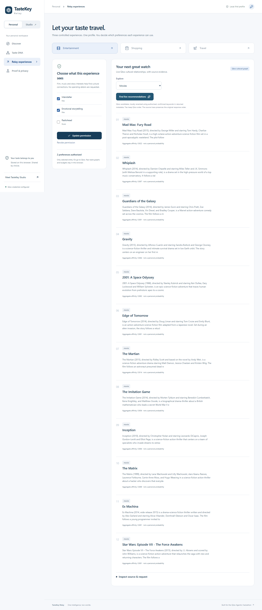

# TasteKey Relay

**One intelligence, two worlds.** A local-first personal taste identity and a private business cultural advisor, sharing a Qloo integration and evidence model.

[Public source repository](https://github.com/marwanehmamouchi05/tastekey-relay) · [Verified CI run](https://github.com/marwanehmamouchi05/tastekey-relay/actions/runs/40368538220)



Screenshots include fixture walkthroughs and verified live-Qloo captures. Live Studio captures use an explicitly synthetic business brief. No screenshot is evidence of actual customer demand or business outcomes.

## Current delivery status

This is an implemented application with tested local workflows. **It is not submission-ready yet.** The event credential is privately configured. Live search, movie recommendations, cross-category books, explainability and a Casablanca location signal have been verified against the issued hackathon endpoint. Entertainment, shopping-brand inspiration, travel destinations, Studio analysis, an accepted action plan and a changed-city/budget scenario also passed a live browser workflow. Event quota/expiry and recommendation quality have not been established. The model adapter has not been tested with a real provider. A durable public deployment is still required. Never describe the synthetic test fixtures as live Qloo evidence.

### Run locally

Install the pinned package manager with `npm install --global pnpm@10.20.0`. Use Node.js 24 LTS or newer (SQLite uses `node:sqlite`; the official harness minimum alone is not sufficient for this application).

```sh
pnpm install --frozen-lockfile
pnpm dev
```

Open [TasteKey Personal](http://localhost:3000/personal/discover) or [TasteKey Studio](http://localhost:3000/studio/onboarding). No account or payment is required for local use. An HTTP-only cookie creates a private 30-day Studio session. Export before clearing cookies: account recovery and cross-device sync are not implemented.

Configure Qloo privately using the supported event harness:

```sh
pnpm qloo -- --version
pnpm qloo -- config set base-url https://hackathon.api.qloo.com
pnpm qloo -- setup --qloo
pnpm qloo -- setup --status
```

Alternatively, copy `.env.example` to `apps/web/.env.local` and configure `QLOO_API_KEY`. Never paste it into chat, source control, a public configuration, or a browser. Restart the server after environment changes. Optional model variables configure an OpenAI-compatible provider; the application does not require a paid model or claim any particular free-tier availability.

```sh
pnpm verify:qloo
```

This live check resolves an unambiguous Interstellar reference and tests movie, book, and Casablanca location requests. It saves actual, public-cultural evidence only after success. It fails honestly without an event credential. The initial live verification is recorded in `docs/live-evidence/qloo-verification.json`. A success does not establish all categories or all Studio markets: validate the actual judge story separately.

### Try Personal

1. In Discover, add a film, music artist, place, or design preference. You can add your own taste without Qloo, or search Qloo and explicitly select the intended reference.
2. Answer an adaptive follow-up. Possibilities remain unverified until answered; rejected interpretations stop influencing authorized contexts.
3. Inspect, move, edit, reject, or delete nodes in Taste DNA. Use the accessible list as an alternative to the interactive graph.
4. Enter a hotel or shopping budget separately from aesthetics. Optional natural-language interpretation requires a configured model and explicit text transmission, then a reviewed application of changes.
5. In Relay, approve selected fields for each context. Permissions expire after 24 hours and can be revoked. Movie/TV, brand, and destination inspiration use Qloo entity IDs. Shopping has a clearly labeled fictional catalog; prices are illustrative. Travel does not claim verified hotel prices or bookable, budget-qualified trips.
6. Proof records self-reported choices on a common candidate pool. No performance gain or user study is claimed. Export or delete all local profile data from this view.

### Try Studio

1. Save a business profile, then reopen or update it. Cultural references must be reviewed search results before a live analysis can run.
2. Run Cultural Analysis. The state-machine workflow selects a category, uses public cultural references and city signals, constrains pilot allocations, and records provenance. Failure creates a saved unavailable analysis with no fictional proposals.
3. Review, revise, accept, or reject strategies. The deterministic planner works with Qloo evidence; optional AI assistance rewrites grounded pilot ideas only when configured and selected. Rejections and outcomes inform subsequent investigations.
4. Change city, budget, product mix or other assumptions in Scenarios. A new investigation is saved with its exact inputs. City changes trigger a different Qloo location request. Budget changes recalculate planning allocations, not financial forecasts.
5. Turn an accepted proposal into an editable Action Plan, or add your own action. Save owners, dates, costs, dependencies, priorities, status, and objectives.
6. Record actual results in Outcome Tracking. Reports persist and are included in future advice. Below-target results reduce future pilot allocations under an explicit planning rule.
7. Customer Intelligence honestly reports insufficient data. Real aggregate collection is not implemented. No individual Personal profile is available to Studio.

## Architecture

```text
apps/web                  Next.js App Router, TypeScript, Tailwind, React Flow
packages/shared-types     Validated request contracts and domain types
packages/taste-engine     Preference, hypothesis, correction state
packages/privacy-engine   Context grants, expiry, revocation, disclosure gate
packages/qloo-adapter     Server-side official CLI; bounded calls and caching
packages/studio-engine    Investigation, constraints, scenarios, outcome learning
packages/agent-orchestrator Optional validated language-model operations
packages/evaluation       Identical-pool Hit@K and rank calculations
tests                     Unit, database integration, browser/API tests
```

Personal data stays in browser storage. Studio uses SQLite and server-owned, randomly generated session capabilities; all record queries include the session tenant. No shared judge account exposes another visitor's records. The public API is under `apps/web/app/api/[...path]/route.ts`.

The event kit requires the official harness (`@qloo/qloo-harness` 0.1.26). The adapter spawns Node with an argument array, never a shell command. Requests time out after 25 seconds, allow at most one retry for selected transient failures, use five-minute public-cultural caching, and allow at most two concurrent Qloo children. Authentication/quota errors do not trigger fallbacks. A configurable application-wide hourly allowance defaults to 100 attempted workflows; this is **our application limit**, not the unverified event quota. Traces contain selected inputs and bounded cultural evidence, never credentials.

The pinned pnpm lockfile applies two security fixes to harness transitive dependencies (`undici` and `brace-expansion`). pnpm is required because the upstream agent package ships an npm shrinkwrap that prevents npm from applying these overrides. Do not generate or use an npm package-lock.

## Verify

```sh
pnpm test
pnpm build
pnpm typecheck
pnpm exec playwright install chromium
ppnpm test:e2e
pnpm audit
```

Browser tests use an isolated SQLite file under `test-results/`. Do not set `reuseExistingServer` against a production instance. Unit fixtures are explicitly synthetic, not recorded API captures. See [evaluation methods](docs/EVALUATION.md), [acceptance status](docs/STATUS.md), and [security](docs/SECURITY.md).

## Public deployment

Use a long-running Node 24 container with a persistent writable volume. A static host or an ephemeral/serverless filesystem cannot run this architecture reliably. This repository includes a Dockerfile and Compose definition; see [deployment instructions](docs/DEPLOYMENT.md). No hosting plan or paid service has been purchased.

## Official references

- [Qloo event starter and supported surfaces](https://github.com/qloo/qloo-hackathon-kit)
- [Event credential rules](https://github.com/qloo/qloo-hackathon-kit/blob/main/docs/API_ACCESS.md)
- [Safe cultural data handling](https://github.com/qloo/qloo-hackathon-kit/blob/main/docs/SAFE_USE.md)
- [Public API documentation](https://github.com/qloo/docs-public)
- [Hackathon submission requirements](https://qloo.devpost.com/)

Source code is MIT licensed. Qloo-derived evidence remains subject to Qloo’s data terms and is not relicensed by this project. Public cultural relationships are not evidence of personal identity, sensitive traits, spending power, or future behavior.
